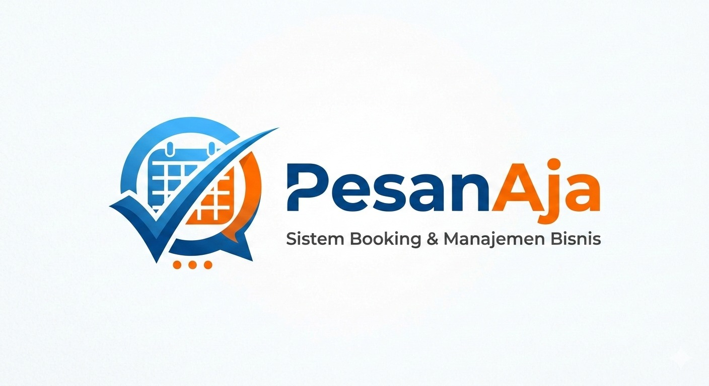

<div align="center">



**Prototipe antarmuka aplikasi booking layanan — salon, spa, laundry, barbershop, cuci kendaraan, dan lainnya.**

[](https://developer.mozilla.org/docs/Web/HTML)
[](https://developer.mozilla.org/docs/Web/CSS)
[](https://developer.mozilla.org/docs/Web/JavaScript)
[](https://web.dev/progressive-web-apps/)
[](#-teknologi)
[](LICENSE)

[**Lihat Demo →**](https://raymclung.github.io/Pesan-Aja/)

</div>

---

> [!IMPORTANT]
> **Ini prototipe antarmuka (UI prototype), bukan aplikasi produksi.**
> Belum ada server maupun basis data — seluruh data disimpan sementara di browser melalui `localStorage`.
> Pemesanan tidak benar-benar terkirim ke mitra bisnis mana pun. Dibuat sebagai tugas kuliah untuk
> mendemonstrasikan alur pengguna dan rancangan antarmuka secara utuh.

## 📖 Tentang

**PesanAja** adalah rancangan aplikasi pemesanan layanan berbasis lokasi. Pengguna dapat menelusuri
bisnis di sekitarnya, memilih layanan, menentukan jadwal, membayar, lalu memberi ulasan — seluruh
alur tersebut sudah tergambar lengkap dalam 20 halaman yang saling terhubung.

Aplikasi ini dibangun **tanpa framework apa pun**. Tidak ada React, tidak ada Bootstrap, tidak ada
langkah build. Hanya HTML, CSS, dan JavaScript murni — cukup buka berkasnya di browser dan aplikasi
langsung berjalan.

## ✨ Fitur

| | Fitur | Keterangan |
|---|---|---|
| 🔍 | **Pencarian bisnis** | Telusuri berdasarkan kategori: salon, spa, laundry, barber, sport, cuci kendaraan |
| 📅 | **Booking bertahap** | Alur multi-langkah: pilih layanan → tanggal → jam → konfirmasi |
| 💳 | **Simulasi pembayaran** | Beberapa metode bayar, termasuk dompet digital *PesanAja Pay* |
| 🎟️ | **Promo & voucher** | Halaman promo beserta manajemen voucher milik pengguna |
| 📦 | **Riwayat pesanan** | Daftar pesanan berjalan dan selesai, lengkap dengan halaman detail |
| ⭐ | **Ulasan & rating** | Beri penilaian setelah layanan selesai |
| 💬 | **Kotak pesan** | Antarmuka percakapan dengan mitra bisnis |
| 🏪 | **Sisi mitra** | Halaman pendaftaran mitra beserta dasbor bisnis |
| 📱 | **PWA** | Dapat dipasang ke layar utama, punya service worker, dan bisa dibuka offline |
| 🎨 | **Mobile-first** | Lebar 480px yang terpusat rapi saat dibuka di desktop |

## 🗂️ Halaman

<details>
<summary><b>Lihat seluruh 20 halaman</b></summary>

<br>

**Sisi pengguna**

| Berkas | Halaman |
|---|---|
| `index.html` | Beranda — pencarian dan kategori layanan |
| `list-bisnis.html` | Daftar bisnis beserta filter |
| `detail-bisnis.html` | Profil bisnis, daftar layanan, dan ulasan |
| `booking.html` | Alur pemesanan bertahap |
| `booking-flow.html` | Pengalih menuju alur pemesanan |
| `payment.html` | Pemilihan metode pembayaran |
| `orders.html` | Daftar pesanan saya |
| `order-detail.html` | Rincian satu pesanan |
| `review.html` | Formulir penilaian dan ulasan |
| `wallet.html` | PesanAja Pay — saldo dan riwayat transaksi |
| `promo.html` | Katalog promo |
| `voucher.html` | Voucher milik pengguna |
| `inbox.html` | Percakapan dengan mitra |
| `profile.html` | Profil pengguna |
| `edit-profile.html` | Penyuntingan data profil |
| `login.html` | Masuk dan pendaftaran akun |
| `tentang.html` | Tentang aplikasi |
| `404.html` | Halaman tidak ditemukan |

**Sisi mitra bisnis**

| Berkas | Halaman |
|---|---|
| `bisnis.html` | Halaman ajakan bergabung sebagai mitra |
| `app.html` | Dasbor pengelolaan bisnis |

</details>

## 🚀 Menjalankan secara lokal

Tidak ada `npm install`, tidak ada proses build.

```bash
git clone https://github.com/raymclung/Pesan-Aja.git
cd Pesan-Aja
```

Lalu jalankan lewat server statis apa pun — diperlukan agar service worker dan PWA berfungsi:

```bash
# Python
python -m http.server 8000

# atau Node.js
npx serve
```

Buka `http://localhost:8000` di browser.

> [!TIP]
> Membuka `index.html` melalui dobel-klik juga bisa, tetapi service worker tidak akan aktif
> karena protokol `file://` tidak mengizinkannya. Untuk mencoba fitur PWA, gunakan server statis.

## 🛠️ Teknologi

| Aspek | Pilihan |
|---|---|
| **Bahasa** | HTML5, CSS3, JavaScript (ES6+, tanpa transpilasi) |
| **Penataan gaya** | CSS murni dengan *custom properties* sebagai token desain |
| **Penyimpanan data** | `localStorage` dan `sessionStorage` |
| **Offline** | Service worker — *network-first* untuk HTML, *cache-first* untuk aset |
| **Tipografi** | Plus Jakarta Sans (Google Fonts) |
| **Dependensi** | Tidak ada |

Seluruh warna, bayangan, dan tipografi didefinisikan sebagai variabel CSS di `:root`, sehingga
tampilan tetap konsisten di semua halaman:

```css
:root{
  --c-primary:#1F4FD9;  --c-accent:#FF7A2D;  --c-teal:#15B79E;
  --c-ink:#0B1726;      --c-muted:#5B6B7E;   --c-line:#E6EAF0;
  --shadow-md:0 12px 32px rgba(11,23,38,.08);
}
```

## 📁 Struktur

```
Pesan-Aja/
├── index.html              # beranda
├── app.js                  # logika aplikasi utama
├── script.js               # utilitas bersama
├── booking-engine.js       # inti perhitungan pemesanan
├── booking-steps.js        # navigasi antar langkah
├── booking-modules.js      # data layanan dan bisnis
├── app-polish.js           # penghalus interaksi + pendaftaran service worker
├── sw.js                   # service worker
├── manifest.json           # manifest PWA
├── style.css               # gaya dasar
├── app.css                 # gaya dasbor
├── booking-flow.css        # gaya alur pemesanan
├── app-polish.css          # penyempurnaan tampilan
└── assets/
    ├── categories/         # ikon kategori layanan
    ├── business/           # foto contoh bisnis
    └── logo.svg, logo.jpg, favicon.svg
```

## 🗺️ Rencana pengembangan

Batasan yang disadari, dan langkah lanjutan bila proyek ini diteruskan:

- [ ] **Menyatukan CSS** — sebagian besar halaman masih memuat `<style>` inline sendiri; perlu dipindahkan ke berkas bersama
- [ ] **Backend sungguhan** — REST API beserta basis data untuk menggantikan `localStorage`
- [ ] **Autentikasi** — saat ini halaman masuk hanya simulasi tampilan
- [ ] **Pembayaran nyata** — integrasi payment gateway seperti Midtrans atau Xendit
- [ ] **Data bisnis dinamis** — daftar bisnis masih ditulis langsung di dalam kode

## 📄 Lisensi

Dirilis di bawah [Lisensi MIT](LICENSE).

---

<div align="center">
<sub>Dibuat oleh <a href="https://github.com/raymclung">@raymclung</a> · Proyek tugas kuliah</sub>
</div>
